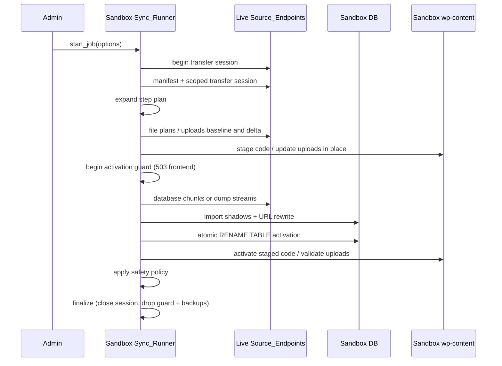

# Architecture

Sandbox Sync is a WordPress must-use plugin installed on both a live (source) site and one or more sandboxes. The sandbox pulls selected database tables and `wp-content` directories over authenticated HTTPS. Database/code changes stage before guarded activation; uploads update in place with bounded failure recovery.

Protocol version: `SANDBOX_SYNC_PROTOCOL` (currently 16). Product version: `SANDBOX_SYNC_VERSION` (currently 0.1.2).

Related docs: [COMPATIBILITY](COMPATIBILITY.md) · [THREAT-MODEL](THREAT-MODEL.md) · [RECOVERY](RECOVERY.md) · [SECURITY](../SECURITY.md)

---

## Repository layout

```
mu-plugin/
  sandbox-sync.php                 Loader (symlink this into wp-content/mu-plugins/)
  sandbox-sync/
    class-auth.php                 Pairing, bearer tokens, sandbox flag, source registry
    class-source-endpoints.php     Live HTTP API (?sandbox_sync=…) at mu-plugin load time
    class-source-state.php         Durable transfer-session / abort state on the source
    class-client.php               Sandbox HTTP client (sessions, manifests, streams)
    class-sync-runner.php          Job planner + slice executor (uses the two traits)
    trait-sync-runner-database.php Table import, shell fast path, search-replace, swap
    trait-sync-runner-files.php    Code/uploads planning, transfer, activation, rollback
    class-job.php                  Persistent job record, lease, log, history helpers
    class-files.php                Manifests, diffs, installs, symlink discovery
    class-uploads-state.php        Per-partition uploads cursor + generation journal
    class-db-exporter.php          Chunked SQL export (source)
    class-table-delta.php          Posts/postmeta index planning + delta application
    class-db-shell.php             Opt-in mysqldump → mysql stream path
    class-db-shell-dump-reader.php Sandbox-side stream integrity for the shell path
    class-search-replace.php       Serialized-aware URL rewrite on shadow tables
    class-safety.php               Post-swap keep/omit rules + activation traffic guard
    class-tar-*.php                Pure-PHP tar export / extract / stream extract
    class-admin-page.php           Tools → Sandbox Sync UI + AJAX controller
    class-cli.php                  WP-CLI commands
    class-env.php / class-error-info.php
scripts/                           Local install, seed, pair, reset, release
tests/                             Dependency-free PHP test suite
docs/                              Compatibility, threat model, recovery, this file
```

Both roles share one codebase. The loader always registers source endpoints, the admin screen, safety hooks, and the cron worker; behavior branches on whether the site holds a connection (sandbox) or paired tokens (source).

---

## Design decisions

These are the choices the codebase commits to today.

### Pull model, live never paused

The sandbox initiates every transfer. The live site keeps serving traffic; exports are best-effort snapshots per table/file, not a frozen consistent cut. Opening-count vs delivered-row drift (and the post-import live comparison) is informational, not a job failure. Transfer integrity still requires that every committed row lands in the shadow (`imported === transferred`).

### One mu-plugin, two roles

Pairing and sync share the same install so protocol, safety, and version stay aligned. A site may be source, sandbox, or (after revoke/disconnect) neither. Multi-sandbox is supported: each sandbox has its own bearer and transfer session.

### Direction guardrails before mutation

1. An admin must explicitly mark the site as a sandbox.
2. A site that still has paired sandboxes refuses to be overwritten.
3. The UI confirmation (and self-URL check) summarize what will be replaced.

### Job = durable step queue + fenced lease

Every sync is a `Job` option: ordered steps, heartbeat, append-only log, and a renewable owner/job fencing lease. AJAX ticks and `sandbox_sync_process_job` cron share `process_slice()`; only one holder mutates. Cancellation is cooperative at checkpoints. Cleanup may delete only resources registered to that job.

### Stage database/code; update uploads in place

- **Database:** import into `ssx_*` shadows → URL search-replace → one `RENAME TABLE` swap under the activation guard → safety rules → finalize drops `ssxbak_*` backups.
- **plugins / mu-plugins / themes:** build a same-filesystem stage (sibling under `wp-content/`), SHA-256 validate against a second source manifest, then activate. On hosts that forbid renaming those directories (WP Cloud: `EPERM` on the directory inode), activation evacuates and promotes top-level children; protected symlinks stay in place. Rollback reverses the same mapping.
- **uploads:** in-place install with quarantine for deletions (no full tree clone). First baseline streams by year; a per-partition cursor commits finished years early so a later failure does not redo them. Incremental mode uses generation journals; `--adopt-uploads` metadata-diffs an existing tree instead of clearing it.

### Transfer session scoped to the job

Each job opens a bearer-bound source grant limited to the selected tables/dirs/plugins/uploads/constants. The idle lease slides on activity, accepts keepalives during local-only work, and can be reconstructed with the same job id and exact scope after a dormant-worker gap.

### Symlinks are sacred

Symlinks are never followed, exported as targets, overwritten, or deleted. Dev checkouts and the sandbox-sync loader itself can live as symlinks without being wiped.

### Safety runs before ordinary traffic sees the clone

After DB swap (and through deferred file activation), an early-load 503 guard pauses the frontend. Tools → Sandbox Sync, its AJAX action, WP-Cron, and WP-CLI remain reachable. Checkable safety rules scrub secrets, neutralize integrations, block mail/HTTP, etc., before the guard drops at finalize — they do not rewrite users or editorial content. Safety defaults and selected live wp-config constants are written into a managed block on the realpath'd site `wp-config.php` (writable docroot); WP-CLI is only a fallback.

### Posts/postmeta row delta (protocol 14+)

When incremental mode is on and a table checksum misses, `wp_posts` / `wp_postmeta` prefer a local clone + row plan (`ID` / `post_modified_gmt` index diff) over a full re-export. The source and sandbox still scan their complete lightweight posts indexes, and the sandbox clones both complete local tables into shadows; this path saves network transfer, not destination database copy, temporary-capacity, or binlog work. Its change signal is only as complete as `post_modified_gmt`, so writes that bypass normal WordPress post-modified semantics require a full sync/audit. Other tables remain checksum-skip or full import. Schema changes and large change sets fall back automatically to full import.

### Opt-in shell DB path

When both sites enable `SANDBOX_SYNC_ALLOW_SHELL_DB` (or the filter) and binaries/`proc_open` are available, large tables stream via `mysqldump` → gzip → sandbox `mysql` with shadow `INSERT` rewriting. Integrity is trailer hash + statement whitelist + attempt-scoped staging rename. Failure falls back to chunked import. Default: CLI workers only.

### Schema-only vs excluded tables

- **Schema-only:** recreate `CREATE TABLE` empty; no source rows (default includes `newspack_newsletters_subscription_attempts`).
- **Excluded:** leave existing sandbox table contents alone (wins if listed in both).

---

## End-to-end flow



### Typical step order

1. `manifest` — fetch source plan; expand remaining steps.
2. Code `dir_plan` / `dir_fetch` / `dir_file` — stage plugins, mu-plugins, themes.
3. Uploads plan / baseline or incremental; `uploads_finalize` starts the guard and closes the final live delta.
4. `refresh_manifest`, then `table` × N — shadow import (chunked, shell, or row delta), `validate_db`, then `search_replace`.
5. `activate` — start the guard if it is not already active and atomically swap the database.
6. `dir_activate` × dirs — promote validated code; validate uploads.
7. `safety` — apply the selected sandbox policy and replicated constants.
8. `finalize` — close the source session, release the guard, drop backups/stages, and write history/report.

Traversal and import work checkpoints its lease, cancellation state, and progress. Resumable steps continue from durable cursors; individual database/host operations can still be bounded by the hosting platform's worker and query timeouts.

### Drivers

| Driver | When |
|--------|------|
| Admin AJAX (`action=sandbox_sync`) | UI open; short slices + live log |
| WP-Cron `sandbox_sync_process_job` | Background jobs; reschedules until done |
| WP-CLI `sandbox-sync run` | Foreground loop calling `process_slice` until terminal |

---

## Auth and HTTP surface

**Source (`?sandbox_sync=`):** handled at mu-plugin load so themes/plugins cannot pollute streams. Notable actions: `handshake`; scoped-session lifecycle; `manifest`; `checksums`; chunked `table` and shell `table_dump`; `tar`; ranged `file`; `files_manifest` and `file_hashes`; `uploads_state`, totals and scopes; plugins; constants discovery/fetch; and progress/cancellation.

**Sandbox:** `Client` holds the sealed bearer, opens/renews the transfer session, and talks JSON or raw streams. TLS verification follows [COMPATIBILITY](COMPATIBILITY.md) (on for public sources).

---

## On-disk / in-DB artifacts (sandbox)

| Artifact | Role |
|----------|------|
| Option `sandbox_sync_job` | Active job |
| Options `sandbox_sync_history`, `sandbox_sync_last_report`, `sandbox_sync_table_state` | History, last report, incremental table checksums |
| Option `sandbox_sync_uploads_cursor` | Per-source, per-partition uploads generations applied by this sandbox |
| `wp-content/.sandbox-sync-work/<job>/` | Manifests, batches, uploads quarantine |
| `wp-content/.sandbox-sync-stage-<job>-{plugins,mu-plugins,themes}` | Code stages |
| `wp-content/.sandbox-sync-bak-<job>-…` | Code rollback children (content-swap) |
| `wp-content/.sandbox-sync-activation-guard.php` | Early-load 503 fence |
| `wp-content/.sandbox-sync-logs/<job>.log` | Durable full job log |
| Tables `ssx_*` / `ssxbak_*` | Shadows and post-swap backups |

Source transfer state lives under `wp-content/.sandbox-sync-transfer-*.php`; source uploads generations live in `wp-content/.sandbox-sync-uploads-state.php` (see `Source_State` and `Uploads_State`).

---

## Testing and release

- Unit suite: `php tests/run-tests.php` (no WordPress bootstrap; shims in `tests/bootstrap.php`).
- Full gate: `composer check` (see [CONTRIBUTING](../CONTRIBUTING.md)).
- Release tarball: `scripts/build-release.sh` (excludes AppleDouble / `__MACOSX`).
